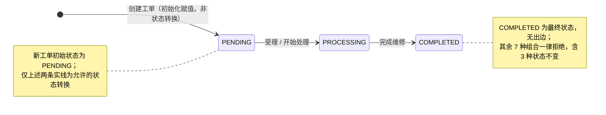
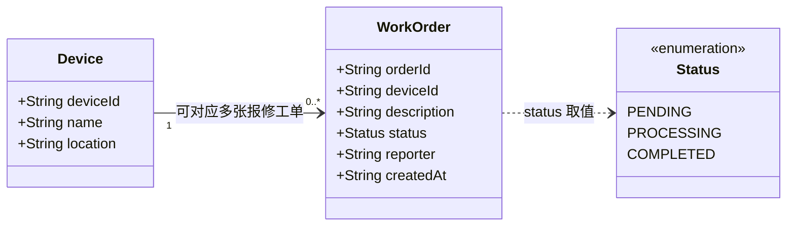

# 状态图与简单类图

> 负责人：L1Uhhl ｜ 任务 Issue：#2 ｜ 本组选定语言：Java
>
> 本文件中的 Mermaid 源文本即「可编辑源材料」，GitHub 会自动渲染为可查看的图；同一份源文本另存于 `docs/assets/*.mmd`。按 `docs/assets/README.md` 的约定，使用 Mermaid 时无需再上传图片导出文件。
>
> 范围说明：本实验只实现状态判断函数 `StatusRule.canTransition`。`Device` 与 `WorkOrder` 是分析模型中的概念类，不在 `src` 中实现，不接入数据库或真实硬件。

## 状态图

**读图约定**

- `[*] --> PENDING` 只表示新工单创建时的初始状态赋值，不属于 `canTransition` 的判断范围。
- 状态与状态之间**只有 2 条转换边**：`PENDING→PROCESSING`、`PROCESSING→COMPLETED`，与 README「固定规则」及 `StatusRuleTest` 的 T01 / T02 一致。
- 图中没有自环、没有回退边、没有跨级边；`COMPLETED` 没有出边，表示终态。拒绝的转换不画成边，避免被误读为允许，统一在下表与 note 中说明。

### 状态取值对照（中文标注与程序枚举一一对应）

| 中文名称 | 枚举值（程序中的唯一权威） | 含义 | 允许的下一状态 |
| --- | --- | --- | --- |
| 待处理 | `PENDING` | 报修人提交后新建工单的初始状态 | `PROCESSING` |
| 处理中 | `PROCESSING` | 维护人员已受理、正在处理 | `COMPLETED` |
| 已完成 | `COMPLETED` | 维修完成，终态 | 无 |

> 中文名称为便于阅读的说明性标注；若需求文档采用其他措辞，一律以 `StatusRule.Status` 的英文枚举值为准。

### 全部 9 种转换的判定表

| 当前 ＼ 目标 | `PENDING` | `PROCESSING` | `COMPLETED` |
| --- | --- | --- | --- |
| **`PENDING`** | 拒绝（状态不变） | **允许**（T01） | 拒绝（T03，跨级） |
| **`PROCESSING`** | 拒绝（回退） | 拒绝（状态不变） | **允许**（T02） |
| **`COMPLETED`** | 拒绝（回退） | 拒绝（T04，回退） | 拒绝（状态不变） |

- 3 个状态 × 3 个目标 = 9 种组合，其中 **2 条允许、7 条拒绝**。
- **状态不变同样拒绝**：主对角线上 3 条（PENDING→PENDING、PROCESSING→PROCESSING、COMPLETED→COMPLETED）全部为拒绝。
- 测试覆盖：T01、T02 期望 `true`；T03（跨级）、T04（终态回退）期望 `false`。剩余 5 条组合未写进测试，但按 README 规则同样必须返回 `false`。
- 对应实现：`src/java/StatusRule.java` 中的 `canTransition(Status current, Status target)` 应只对上述 2 种组合返回 `true`，其余（含 `null` 之外的所有组合）返回 `false`。

## 简单类图

**属性依据与关系说明**

- `Device` 的 3 个属性直接取自 `data/devices.csv` 的表头 `deviceId,name,location`（示例：`DEV-001` / 温湿度传感器 / A101教室）。
- `WorkOrder.deviceId` 是指向 `Device` 的关联字段，体现「每张工单对应 1 台设备」。
- `WorkOrder.status` 取值来自 `Status` 枚举，与状态图的 3 个状态完全一致；每次状态变更都须先经 `canTransition` 判定。
- `orderId` / `reporter` / `createdAt` 为识别工单、记录报修信息的最小描述，本实验不实现持久化。
- 关系：`Device "1" --> "0..*" WorkOrder` —— **一台设备可以有 0 到多张工单，每张工单恰好对应 1 台设备**。`0` 表示设备尚未发生报修，`*` 表示同一设备可多次报修。

- `WorkOrder.description` 对应 FR-02「填写故障描述」的输入，是报修工单的必要信息；异常结果里「故障描述为空则拦截提交、不生成工单」也依赖此字段，与 docs/requirements.md 保持一致。

## 与需求的一致性检查

- [x] 中文状态与程序英文值对应 —— 3 个中文标注与 `StatusRule.Status` 的 `PENDING` / `PROCESSING` / `COMPLETED` 一一对应，见「状态取值对照」。
- [x] 只允许两条转换 —— 状态图仅 2 条状态间转换边；9 种组合判定表中恰有 2 条允许、7 条拒绝（含 3 条状态不变），与 README 固定规则、`StatusRuleTest` 的 T01~T04 一致。
- [x] 一台设备与多张工单关系清楚 —— 类图标注 `1 : 0..*`，并说明每张工单恰好对应 1 台设备。

## 图源文件

| 文件 | 内容 | 作用 |
| --- | --- | --- |
| `docs/models.md` | 本文件内嵌的两段 Mermaid 源文本 | GitHub 自动渲染，可直接查看与编辑 |
| `docs/assets/state-diagram.mmd` | 状态图 Mermaid 源文本 | 与上文状态图代码块逐字一致，便于单独编辑 |
| `docs/assets/class-diagram.mmd` | 类图 Mermaid 源文本 | 与上文类图代码块逐字一致，便于单独编辑 |

源文本即「可编辑源材料」，`.mmd` 与 `docs/models.md` 中的代码块来自同一份内容；按 `docs/assets/README.md` 的约定，使用 Mermaid 时无需再提交图片导出文件，因此不存在「源文件与导出图不一致」的风险。

