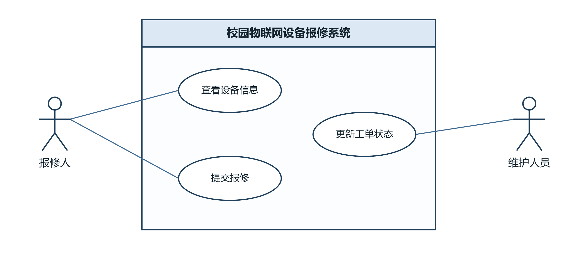

# 用例图与角色说明

## 用例图

可编辑源文件为 assets/usecase.drawio，源文件与导出图内容一致。

## 角色说明
报修人：使用校园物联网设备的师生，参与“查看设备信息”和“提交报修”两个用例。先查看设备清单确认设备编号和位置，再对故障设备提交带故障描述的报修，形成初始状态为 PENDING 的工单。

维护人员：负责设备维修，参与“更新工单状态”用例。通过“开始维修”把工单从 PENDING 转为 PROCESSING，通过“完成维修”把工单从 PROCESSING 转为 COMPLETED。跳过处理中直接完成、以及任何回退或状态不变的转换都被拒绝。

系统边界为“校园物联网设备报修系统”，三个用例都在边界内；两个角色与用例的连接关系见上面的图。

## 图的自查
- [x] 两个参与者
- [x] 三个主要用例
- [x] 系统边界清楚
- [x] 参与者与用例连接正确
- [x] 源文件与导出图内容一致
